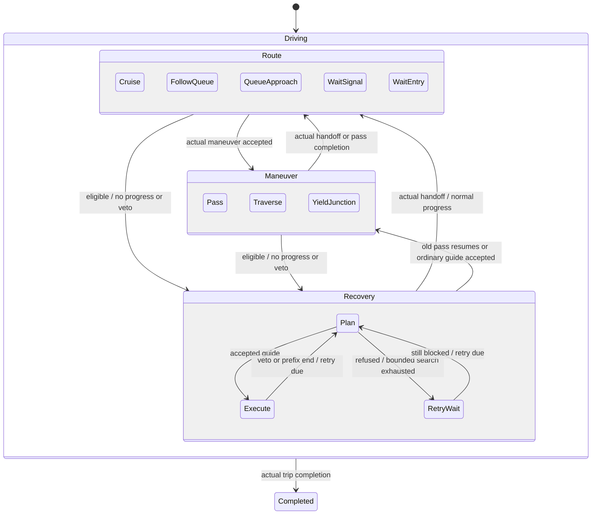

# Native driver actors and statechart

Every admitted trip has one value-owned `Driver` actor, addressed by its stable vehicle ID. `src/sim/driver_actor.odin` implements its statechart directly in Odin. This uses the [statechart](https://stately.ai/docs/statecharts) and [actor](https://stately.ai/docs/actor-model) concepts, not the JavaScript XState runtime. There are no per-driver threads, wall-clock timers, generic chart engine or graphical chart editor.

## Ownership and tick protocol

The actor owns its decision state, intent, retry deadline, actual no-progress timer and previous execution/plan feedback. The world owns physical vehicle poses, lane/connector execution, signals, routes and demand. A motion helper returns facts; it cannot independently change the driver's decision state. `Driver.mode` is only an actor-published legacy inspector projection, retained for existing consumers and historical native captures. It is not a decision input.

Each native serial turn processes this fixed, bounded inbox protocol:

1. **Perceive:** read the current world and the actual guide-based following observation.
2. **Tick:** the actor processes one event to completion and emits `Continue`, `Pass` or `Recover`.
3. **Maneuver_Result:** if requested, execute the existing passing or bounded steering service and deliver its acceptance/refusal. Result events do not emit another maneuver request.
4. **Execute:** apply the normal speed/following controller and authoritative movement guards. Recompute following only if an accepted maneuver changed the guide.
5. **Motion_Result:** deliver actual travelled metres, completion and the execution veto, if any. The actor updates its state and timers.

There is at most one maneuver request per driver per tick, not an unbounded event/action loop. The inbox is drained synchronously: no undelivered external queue is hidden outside the saved actor value. Successful admission creates a trip actor; actual trip completion removes it. Pending arrivals are not discarded or represented as active actors.

Serial array order remains stable; later drivers observe earlier committed motion. Entry-sequence conflict priority is unchanged. This is deterministic but deliberately **not order-independent**. Actors do not mutate neighboring actors. A whole-tick perception/intent/commit scheduler would change these semantics and is outside this slice. Normal gameplay still steps at 50ms; `sim.step` retains its existing at-most-50ms substeps. Rendering still interpolates authoritative simulation poses without feeding presentation back into decisions.

## Hierarchy

Leaves and their parents are explicit in `driver_state_parent`; `driver_state_path` provides the inspector path. The shared **Driving** signal guard suppresses recovery at a mandatory red/amber stop-bar hold. The shared **Recovery** deadline applies to Plan, Execute and RetryWait. A yielding recovery retains its Recovery identity rather than being relabelled as a junction follower. A working, moving guide remains stable after its retry deadline; expiration alone does not replace it. There are no parallel or history regions because this behavior does not need them.

`Continue` means follow the existing route/controller, including guarded junction admission; it is not permission to enter on red. Entry failures produce WaitEntry rather than forcing a new route. QueueApproach anticipates a road-local passing candidate within the existing 35m range; unlike FollowQueue it does not assert actual guide-based following contact. This preserves passing opportunities beyond the controller's shorter acceleration-relevant lookahead. Pass includes the existing shorter same-link motorcycle maneuver; its legacy mode projection can say Filtering.

## Progress, recovery and feedback

`Driver.actor.no_progress` measures consecutive executed no-progress time. Travel greater than 0.000001m resets it; mandatory signal holds reset it too. A slowly moving queue is not automatically stuck. `Driver.waited` separately retains queue patience for the existing passing preferences, including time spent slowly following or waiting at a signal; it does not prove a stall. An eligible driver may reconsider after 0.25s without progress, immediately after a real movement veto or a nearby stationary following obstruction, or near a partial/blocked guide endpoint. Physical eligibility is still checked by the service. A slowly approaching rider can maneuver around a genuinely stopped leader without first having to stop too; a moving leader is not treated as stationary.

The actor allows recovery requests at most twice per simulated second (`replan_after`). The unchanged search uses at most 2,048 expansions, 8,192 states and 32 forward actions of 0.25m. It retains the intended exit, actual initial pose and entry priority. Full aligned receiving-strip containment is required for handoff. Partial paths brake before their endpoint and replan; they do not certify the rest of a route.

Execution feedback distinguishes a signal hold, actual following leader, body contact, predicted conflict, lane-rear veto, pavement veto, unsupported geometry (`Motion_Problem`), protected approach, route boundary, partial endpoint and failed bounded search. Body/prediction/rear queries report the vetoing trip ID where available. Last maneuver feedback remains separate from last movement feedback: a failed plan must not disappear just because the old guide was tried again. `Search_Limit` and `No_Plan` never mean that all physically possible routes were proved impossible.

Ordinary left turns retain the existing committed-turn speed/acceleration targets after queue patience has accumulated. A continuous 0.25s junction yield also establishes a remembered commitment; interleaved moving samples reset that junction-yield timer, while an already established commitment survives resumed movement. Actual no-progress remains separate from both preferences. These are synthetic controller rules, not calibrated driving dynamics.

## Safety and acceptance

Actors choose attempts, not safety exemptions. Existing body SAT, sampled swept movement, actual-asphalt containment, local rolling forecasts, stop/crossing geometry, lane-rear checks and intended route boundaries remain authoritative. Recovery cannot reverse, enter an opposing carriageway, change its route, shrink a vehicle, widen pavement or teleport. Demand conservation remains `spawned = completed + active` and configured `requested = spawned + pending`.

Core tests cover actor transitions, real no-progress versus moving queues and signal holds, bounded retry timing, helper feedback/ownership, safe progress past fixed blockers and exact native replay. Preserved full-scene captures retain all surrounding traffic. The receiving-queue case includes an independent 7m witness and requires real progress beyond the obstruction. Packed-queue and opposing-strip probes remain negative controls: a clear short arc is not a complete compliant passing corridor.

The architecture improves ownership and explains failed attempts. The previously captured escape regressions already passed before this refactor; passing them again is regression evidence, **not a demonstrated new jam fix**. New escape claims require a preserved additional failure with independently established usable space and safe useful execution. General gridlock, cooperative negotiation, congestion-aware routing, reversing and opposing-lane maneuvers remain outside this implementation.
